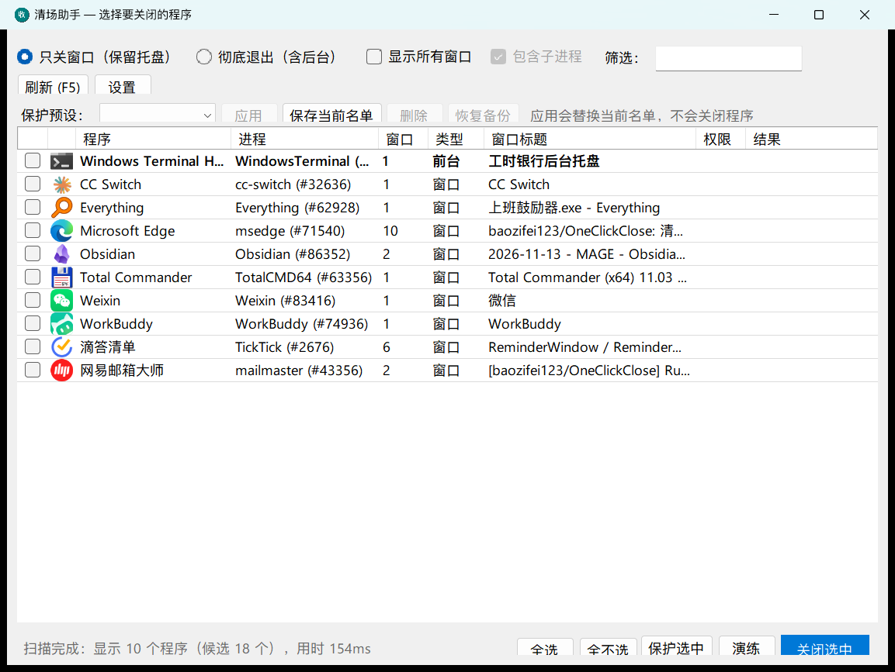

# 清场助手 · OneClickClose

[](https://github.com/baozifei123/OneClickClose/actions/workflows/build.yml)
[](https://github.com/baozifei123/OneClickClose/releases)
[](LICENSE)


> 按下 `Ctrl + Alt + X`，勾选程序，一键关闭。

清场助手是一个 Windows 批量关闭工具。它把当前打开的程序整理成清单，勾选后一次性关闭：既可以像点窗口右上角的 × 那样礼貌关窗，也可以连托盘、后台进程和子进程一起彻底退出。

任务管理器也能结束进程，但它不区分「关窗口」和「杀进程」，不会在动手前列出会影响到哪些进程，也没有保护名单。清场助手只专注把这件事做安全。



## 功能

- **热键唤出**：默认 `Ctrl + Alt + X`，也可以单击托盘图标；再按一次隐藏。
- **按程序分组**：同一可执行文件的多个进程合并为一项，显示图标、进程名、窗口数和权限标记。
- **默认只看任务栏**：只列出任务栏上有按钮的程序；需要时切换「显示所有窗口」。
- **两种关闭模式**：只关窗口（保留托盘），或彻底退出（含后台与子进程）。
- **执行前预览**：逐项列出应用、PID、窗口标题、子进程和将执行的动作；可取消勾选，也可以只演练不执行。
- **保护名单**：系统关键进程硬保护；支持按进程名、按完整路径保护，并可保存为命名预设。
- **安全复核**：动手前复核 PID、进程名、路径和启动时间，降低 PID 复用导致误杀的风险。
- **管理员程序**：权限列会标记需要提权的程序，可从托盘一键以管理员身份重启。
- **轻量常驻**：托盘运行、可选开机自启、单实例；第二次启动只唤回已有窗口。

## 下载与安装

从 [Releases](https://github.com/baozifei123/OneClickClose/releases) 下载最新版本。界面和安装向导均为简体中文。

| 形式 | 文件 | 说明 |
| --- | --- | --- |
| 安装版（推荐） | `OneClickClose-Setup-<version>.exe` | 按当前用户安装到 `%LOCALAPPDATA%\Programs\OneClickClose`，无需管理员权限；可选桌面快捷方式和开机启动。卸载时保留 `config.json`。 |
| 便携版 | `OneClickClose-Portable-<version>.zip` | 解压到任意可写目录，运行 `OneClickClose.exe`。配置写在 EXE 同目录，放在只读目录会保存失败。 |

**系统要求**：Windows 10 / 11 x64。程序基于 .NET Framework 4.8，系统自带，无需额外安装运行时。

> 当前版本未做代码签名，从网络下载后首次运行可能触发 SmartScreen 提示。介意的话可以从源码自行构建。

<details>
<summary>从旧版本升级（“一键收摊” → “清场助手”）</summary>

1.0 版把用户可见名称从“一键收摊”改为“清场助手”，EXE 仍为 `OneClickClose.exe`，安装器 AppId、配置路径和单实例名保持不变。首次启动会把旧的 `一键收摊.lnk` 开机启动项迁移为 `清场助手.lnk`；安装器升级时会清理旧的开始菜单/桌面快捷方式，保护名单和预设不会丢失。

如果旧版已经设置开机启动，建议先安装并运行新版。直接运行便携版时，迁移后的开机启动项会指向便携版所在目录；需要固定到安装目录时，可在设置里关闭再开启开机启动。

</details>

## 快速上手

1. 启动程序：安装版安装完成后可直接启动；便携版运行 `OneClickClose.exe`。
2. 按 `Ctrl + Alt + X` 或单击托盘图标打开清单，再按一次隐藏。
3. 勾选要关闭的程序，在底部选择模式，点「关闭选中」。
4. 彻底退出模式会先弹出预览，确认后才执行；想先看效果可以点「演练」。
5. 右键程序 → 「加入保护名单（永不关闭）」，或勾选后点「保护选中」；受保护的程序会灰色显示。
6. 点「设置」或托盘菜单 → 「设置」，可修改热键、优雅关闭超时、默认视图、子进程默认值和开机启动。
7. 需要管理员权限时，从托盘 → 「以管理员身份重启」（会触发 UAC）。
8. `Esc` 或右上角 × 只是隐藏窗口；真正退出请右键托盘图标 → 「退出」。

启动参数 `--hidden` 表示只驻留托盘、不显示面板。第二次启动不会弹“已在运行”，而是唤醒已有实例。

## 两种关闭模式

| | 只关窗口（保留托盘） | 彻底退出（含后台） |
| --- | --- | --- |
| 做什么 | 向可见窗口发送 `WM_CLOSE`，等效于点 × | 先请求关闭，超时后强制结束 |
| 后台/托盘程序 | 不处理 | 一并结束 |
| 子进程 | 不处理 | 默认包含，可在预览中取消 |
| 未保存数据 | 由程序自行决定保存 | 可能丢失 |
| 逐窗口选择 | 支持 | — |
| 适合 | 日常收尾，保留常驻程序 | 彻底清理，释放内存和句柄 |

- 程序忽略 `WM_CLOSE` 时，只关窗口模式不会强杀，结果列显示「窗口未响应」。
- 彻底退出模式默认等待 5 秒（`gracefulTimeoutSeconds` 可调），超时后执行强制结束。没有可见窗口的后台程序没有优雅关闭通道，会在确认后直接结束。

## 安全设计

- **硬保护**：Windows 关键进程、安全组件和常见输入法不会出现在清单里。
- **父进程链保护**：本程序自身及其启动者的父进程链不会被关闭。
- **身份复核**：执行前重新核对 PID、进程名、可执行文件路径和进程启动时间；子进程还会核对父进程链，降低 PID 复用导致误杀的风险。
- **先预览后执行**：彻底退出模式逐项列出目标、权限和动作，可取消个别目标，或勾选「仅演练，不执行」。
- **子进程扩展有边界**：不会把系统关键进程或本程序的父进程链带进来。
- **用户保护名单**：支持按进程名、按完整路径保护，并可保存为命名预设；应用预设只改变规则，不会关闭任何程序。

<details>
<summary>默认硬保护的进程（节选）</summary>

- Windows 关键进程：`explorer`、`dwm`、`csrss`、`winlogon`、`services`、`lsass`、`svchost`、`sihost`、`ctfmon`、`TextInputHost` 等。
- 安全与系统组件：Defender 相关进程、`RuntimeBroker`、`dllhost`、`LockApp`、`OpenConsole`、音频/显卡容器等。
- 输入法：搜狗、QQ 拼音、百度拼音、微信输入法等。
- 本程序自身的整条父进程链。

</details>

## 配置

配置文件默认是 EXE 同目录的 `config.json`，首次运行自动生成。原生版和 PowerShell 版共用同一份 schema（v2），旧配置可以直接读取，新增字段缺省时使用安全默认值。

<details>
<summary>配置字段</summary>

```json
{
  "schemaVersion": 2,
  "hotkey": "Ctrl+Alt+X",
  "gracefulTimeoutSeconds": 5,
  "protectedProcesses": [],
  "protectedPaths": [],
  "lastMode": "windows",
  "profiles": {
    "工作": ["teams", "outlook"]
  },
  "activeProfile": "工作",
  "showAllWindows": false,
  "includeChildProcesses": true,
  "includeSuspendedUwp": false
}
```

| 字段 | 说明 |
| --- | --- |
| `schemaVersion` | 当前为 `2`；旧格式仍可读取，首次保存时升级。 |
| `hotkey` | 全局热键，支持 `Ctrl` / `Alt` / `Shift` / `Win` 组合，主键支持 `A-Z`、`0-9`、`F1-F24`。 |
| `gracefulTimeoutSeconds` | 优雅关闭的等待秒数，1–60。 |
| `protectedProcesses` | 当前用户保护名单（进程名数组，带不带 `.exe` 均可）。 |
| `protectedPaths` | 按完整可执行文件路径保护，与进程名规则叠加生效；不包含在命名预设中。 |
| `lastMode` | 上次使用的模式：`windows` 或 `all`。 |
| `profiles` | 命名保护预设：名称 → 进程名数组。 |
| `activeProfile` | 当前关联的预设；手工修改保护名单或路径规则后会清空。 |
| `showAllWindows` | 启动时是否默认显示所有窗口。 |
| `includeChildProcesses` | 彻底退出时是否默认包含子进程，默认 `true`。 |
| `includeSuspendedUwp` | 是否在任务栏视图中显示挂起的 UWP 应用，默认 `false`。 |

</details>

<details>
<summary>保护预设与配置备份</summary>

- **保存当前名单**：把当前 `protectedProcesses` 存为可复用预设；覆盖同名预设会再次确认。
- **应用**：用预设替换当前保护名单，只改变规则，不会关闭任何程序。
- **删除**：只删除预设，不改变当前保护名单。
- 每次保存配置前，旧文件会自动保留为 `config.json.bak`。视图类高频偏好使用轻量保存，只原子更新 `config.json`，不轮换 `.bak`，避免冲掉有意义的配置备份。
- 「恢复备份」会先把当前配置保存为 `config.json.pre-restore-<时间戳>-<随机标识>`，再从 `.bak` 恢复。恢复点不会自动删除，可在程序退出后手动清理。
- 修改热键后原生版会立即重新注册，无需重启；PowerShell 版需要退出并重启。
- 不要在程序运行时手工编辑配置文件，以免下一次保存覆盖外部更改。

</details>

## 已知限制

- **托盘图标没有官方枚举 API**：后台程序通过「当前用户会话 + GUI 子系统 + 父进程过滤」识别，个别驱动/助手进程可能出现在列表里，加入保护名单即可。
- **任务栏过滤是窗口样式启发式**：会排除工具窗口、owner 窗口和 DWM cloaked 窗口；被最小化或挂起的 UWP 应用默认可能不显示。
- **UWP 应用**的窗口由 `ApplicationFrameHost` 托管：只关窗口模式可以正常关闭；彻底退出模式会保护宿主进程，避免一次杀掉所有 UWP 应用。
- **管理员权限的程序**：非管理员运行时，`WM_CLOSE` 和强杀都可能被 UIPI 拦截，可从托盘以管理员身份重启后重试。
- **子进程**：默认包含选中程序的子进程，可能结束终端里正在运行的任务、更新器或辅助进程；预览中可以逐项取消。
- **忽略 `WM_CLOSE` 的程序**：只关窗口模式不会强杀，结果列显示「窗口未响应」，请改用彻底退出模式。
- **保存时间较长的程序**：调大 `gracefulTimeoutSeconds`，避免保存未完成就被结束。
- **无标题或工具窗口**可能识别不到；目前只处理有标题的可见顶层窗口。
- **未做代码签名**：从网络下载后运行可能触发 SmartScreen 提示，正式分发前建议配置代码签名证书。
- **便携版配置写在 EXE 同目录**：放在 `Program Files` 等不可写目录会保存失败，请使用安装版或改放到可写目录。
- 本工具不会替你保存文档，强制结束的后果需要自行承担。

## 从源码构建

需要 Windows 10 / 11 x64 和 .NET SDK 10（编译 `net48` 时会自动还原 .NET Framework 4.8 参考程序集）。制作安装包还需要 Inno Setup 6。

```powershell
dotnet build .\src\OneClickClose.App\OneClickClose.App.csproj -c Release
dotnet test .\tests\OneClickClose.Tests\OneClickClose.Tests.csproj -c Release
```

<details>
<summary>打包与代码签名</summary>

```powershell
dotnet publish .\src\OneClickClose.App\OneClickClose.App.csproj `
  -c Release -o .\dist\app `
  -p:DebugType=None -p:DebugSymbols=false

& "C:\Program Files (x86)\Inno Setup 6\ISCC.exe" .\installer\OneClickClose.iss
```

产物：

- `dist\app\OneClickClose.exe`：便携版入口（同目录 DLL 必须一起保留）。
- `dist\installer\OneClickClose-Setup-<version>.exe`：按用户安装包。

`scripts/sign.ps1` 使用 Windows SDK 的 `signtool.exe` 对程序和安装包签名并验证。仓库不包含任何证书或密码；没有证书时脚本会明确报错。

```powershell
# 使用当前用户证书存储中的证书
.\scripts\sign.ps1 -CertificateThumbprint <THUMBPRINT>

# 或使用 PFX；密码建议放在环境变量，避免出现在命令行历史
$env:ONECLICKCLOSE_PFX_PASSWORD = '<password>'
.\scripts\sign.ps1 -PfxPath .\cert.pfx
```

</details>

## 项目结构

| 路径 | 作用 |
| --- | --- |
| `src/OneClickClose.App/` | 原生 C# WinForms 主程序（.NET Framework 4.8） |
| `tests/OneClickClose.Tests/` | 原生版 xUnit 回归测试 |
| `installer/OneClickClose.iss` | Inno Setup 按用户安装包脚本 |
| `installer/ChineseSimplified.isl` | 安装器简体中文语言文件（来自 Inno Setup 官方仓库） |
| `scripts/sign.ps1` | 代码签名/验证脚本（需要证书） |
| `.github/workflows/build.yml` | CI：测试、发布、打包、可选签名 |
| `OneClickClose.ps1` | PowerShell 5.1 版主程序（维护冻结） |
| `Start-Hidden.vbs` | PowerShell 版无窗口启动 |
| `config.json` | 用户设置与保护名单，首次运行自动生成（不纳入版本控制） |

## 测试

原生版使用 xUnit；CI 在 Windows runner 上执行 `dotnet test`、Release publish、便携 ZIP 打包和 Inno Setup 编译，并上传产物。配置 `SIGNING_CERTIFICATE_BASE64` / `SIGNING_CERTIFICATE_PASSWORD` secrets 后会自动调用签名脚本。

<details>
<summary>测试覆盖范围</summary>

- 旧配置迁移、schema v2、新视图字段默认值、预设保存/应用/删除、路径保护、备份轮换、轻量保存不轮换备份、恢复点、保存失败回滚。
- Toolhelp 进程元数据（当前进程路径/父 PID）、权限判断、进程树祖先/后代/环检测。
- 按路径分组、未知路径 PID 独立、保护标记、排序、挂起 UWP/权限标记聚合。
- 任务栏窗口资格（普通窗口入选、工具窗口排除）、组内任一窗口入选、默认过滤、“显示所有窗口”和“包含挂起 UWP”开关。
- 热键解析与回退。
- 两个 charmap 测试进程的同组预览、取消不关闭、确认后关闭。
- 只执行预览中勾选的目标、演练不关闭、逐窗口目标过滤、启动时间不匹配跳过、子进程扩展与关闭。
- 设置/预览/窗口选择窗体构建、离屏 WinForms 扫描与列表构建冒烟测试。

测试环境：Windows 11 22621 / .NET Framework 4.8 / .NET SDK 10。

</details>

## PowerShell 版（维护冻结）

PowerShell 5.1 版保留为回退和调试入口，已进入维护冻结：不再接收新功能，只接受关键修复。原生版的新功能（进程树、设置面板、逐窗口选择、演练、挂起 UWP、路径保护、管理员重启等）不会同步到 PowerShell 版。

从 PowerShell 版迁移时，把旧版 `config.json` 复制到原生版 EXE 同目录即可。两个版本使用独立的单实例互斥量，可以同时打开做对比测试，但不能同时注册同一个全局热键。

<details>
<summary>运行与回归测试</summary>

日常隐藏运行：双击 `Start-Hidden.vbs`；或直接运行 `OneClickClose.ps1` 显示面板。

```powershell
powershell.exe -NoProfile -ExecutionPolicy Bypass -File .\OneClickClose.ps1
powershell.exe -NoProfile -ExecutionPolicy Bypass -File .\OneClickClose.ps1 -Hidden
```

回归测试（需要 Windows PowerShell 5.1，WinForms 测试建议加 `-STA`）：

```powershell
powershell.exe -STA -NoProfile -ExecutionPolicy Bypass -File .\OneClickClose.ps1 -SelfTest
powershell.exe -STA -NoProfile -ExecutionPolicy Bypass -File .\OneClickClose.ps1 -RefreshTest
powershell.exe -STA -NoProfile -ExecutionPolicy Bypass -File .\OneClickClose.ps1 -SafetyTest
powershell.exe -STA -NoProfile -ExecutionPolicy Bypass -File .\OneClickClose.ps1 -ConfigTest
powershell.exe -STA -NoProfile -ExecutionPolicy Bypass -File .\OneClickClose.ps1 -TaskbarTest
powershell.exe -STA -NoProfile -ExecutionPolicy Bypass -File .\OneClickClose.ps1 -ProtectRefreshTest
powershell.exe -STA -NoProfile -ExecutionPolicy Bypass -File .\OneClickClose.ps1 -CloseTest
powershell.exe -STA -NoProfile -ExecutionPolicy Bypass -File .\OneClickClose.ps1 -UiTest
```

</details>

## 参与贡献

欢迎提交 Issue 和 Pull Request。功能开发集中在原生版（`src/OneClickClose.App`），提 PR 前请确保 `dotnet test` 通过；涉及关闭行为的改动，请同时补充对应的 xUnit 测试。

## 许可证

本项目采用 [MIT License](LICENSE)。

## 致谢

实现时参考了以下开源项目的思路（未复制无许可代码）：

- [voolyvex/pcpow](https://github.com/voolyvex/pcpow)（MIT）：优雅关闭 → 超时 → 强杀，保护进程树。
- [ntaraujo/killer](https://github.com/ntaraujo/killer)（MIT）：多选列表批量结束进程。
- [aimansddiq/close-all-windows](https://github.com/aimansddiq/close-all-windows)（无 license）：`EnumWindows` + `WM_CLOSE` 的 PowerShell 写法，仅作技术参考。
- [Aldaviva/KillUnwantedProcesses](https://github.com/Aldaviva/KillUnwantedProcesses)（Apache-2.0）：保护名单与条件判断思路。

安装器简体中文语言文件来自 [Inno Setup 官方仓库](https://github.com/jrsoftware/issrc) 的 `Files/Languages/ChineseSimplified.isl`。
